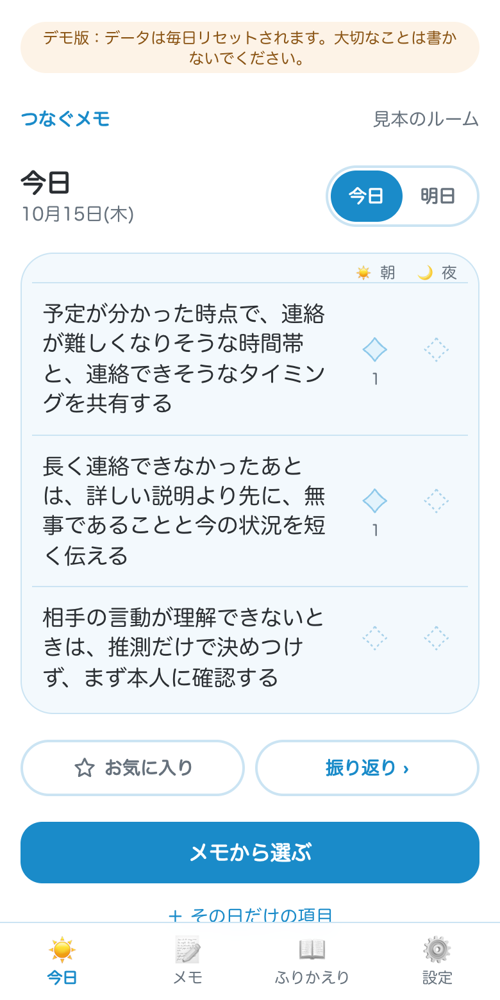
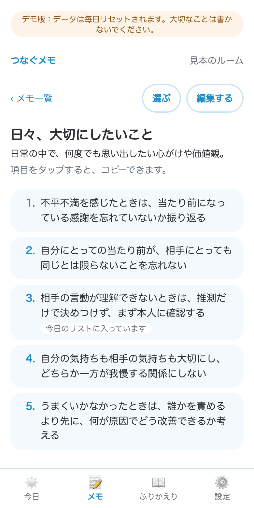
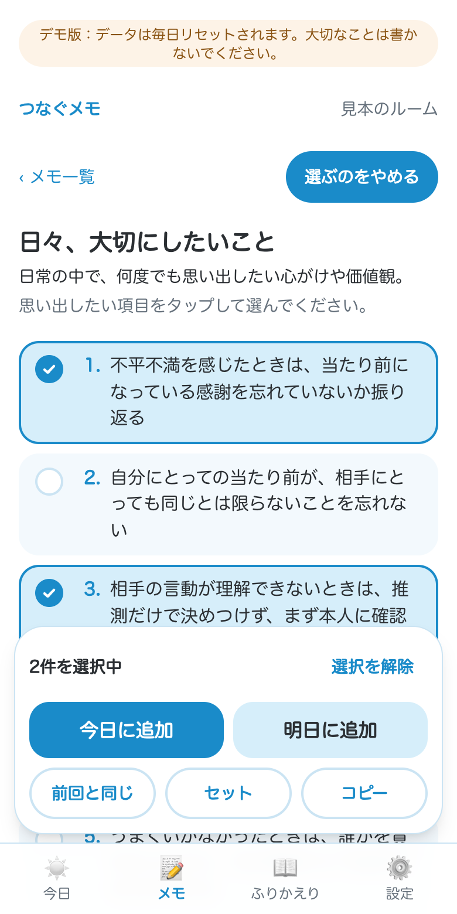
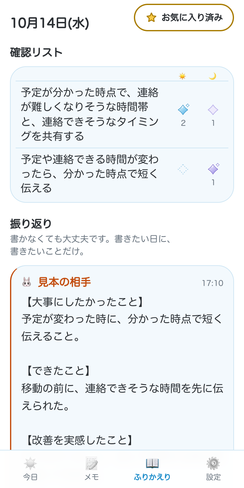
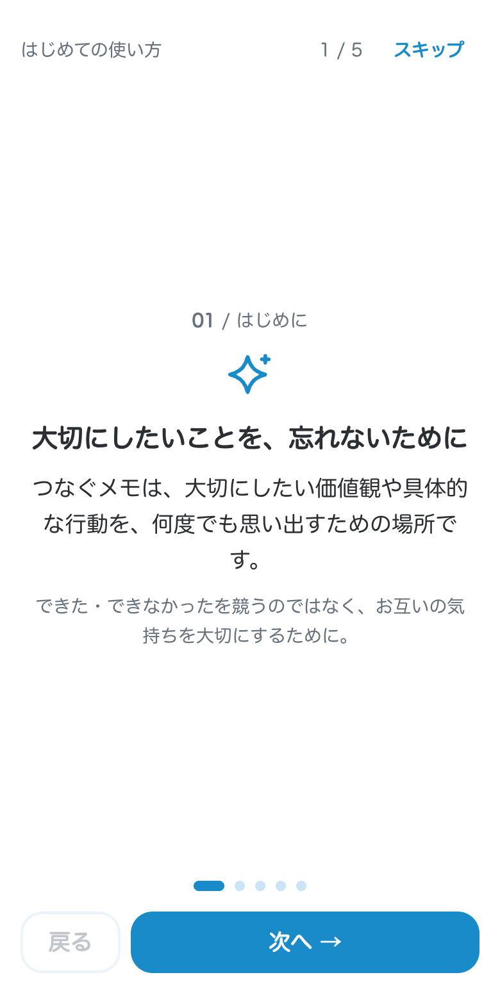

# つなぐメモ

**大切にしたいことを、一緒に何度でも思い出すために。**

パートナー・家族・友人など、身近な人と価値観や具体策を共有し、日々の行動と振り返りにつなげるスマホ向けWebアプリです。

**[デモを試す](https://tsunagu-memo-demo.vercel.app)** — 「デモで試す」から、見本のメンバーがいるルームを体験できます。作成から24時間以上たったデモデータは、毎日1回（日本時間の午前3時）の定期処理で自動削除されます。そのため、作成したタイミングによっては最長で約48時間残ることがあります。

<table>
  <tr>
    <td align="center"><br>今日の確認リスト</td>
    <td align="center"><br>メモ</td>
    <td align="center"><br>メモから選ぶ</td>
    <td align="center"><br>振り返り</td>
    <td align="center"><br>初回ガイド</td>
  </tr>
</table>

<sub>画面はデモ環境の見本ルームです（iPhone 幅・ライトモード）。</sub>

## 1. サービス概要

「つなぐメモ」は、少人数のルームで、大切にしたい価値観や具体策をメモに残し、必要に応じて追加・編集できる共有アプリです。メモはメンバー間で共有され、変更もリアルタイムに反映されます。

保存したメモから、意識したい項目を選んでおき、**☀️朝に確認 → 🌙夜に振り返る → 必要なら追記・⭐で見返す**。

メモは繰り返し使え、確認項目は前日のうちに準備したり、前回と同じ内容を簡単に選び直したりできます。

振り返りの記入は任意。書く内容に迷ったときの見出し挿入ボタンや、メンバー同士で追記できる仕組みも用意しています。一人では忘れてしまいがちなことも、誰かと共有することで自然と思い出すきっかけにつなげます。

「できた・できなかった」を数えるタスク管理アプリではなく、大切にしたいことを意識し続け、うまくいかなかった日も責めずに次につなげることを目指しています。

## 2. 作ったきっかけ

大切なことを話し合い、十分に理解し、今度こそ行動に移そうと決めても、予想外の出来事や余裕のない状況では、思うように実践できないことがあります。

その結果、すれ違いが深刻になったり、「分かっていたのに、またできなかった」と自分を責めたりすることもあります。

**大切にしたい気持ちがあるからこそ、思うように行動できなかったときに、自分や相手を責めるだけで終わってほしくない。**

本人の意識や努力だけに委ねるのではなく、大切にしたい気持ちを行動につなげる仕組みを作れないだろうか。そんな思いから「つなぐメモ」を考えました。

## 3. 課題の整理

### 3-1. 表に見えている困りごと

大切にしたいことを理解していても、目の前の出来事に追われると、必要な行動を優先できないことがあります。落ち着いてから振り返る機会がなければ、対応が足りなかったことに気づくのが遅れ、すれ違いや不安が長引く可能性もあります。

### 3-2. なぜなぜ分析（真因の仮説）

**問題：大切にしたいことを理解しているのに、必要な場面で行動に移せないことがある。**

1. **なぜ1：** 予想外の出来事や余裕のない状況では、大切なことを思い出し、何を優先してどう行動するか判断するのが難しくなるから。
2. **なぜ2：** 大切にしたいことを実践できるかどうかが、その場で自分自身が思い出し、判断できるかに依存しているから。
3. **なぜ3（真因の仮説）：** 余裕のあるときに具体策を準備し、必要な日に確認できるようにする仕組みが不足しているから。

### 3-3. 本当に解決したい課題

「次はもっと気をつける」という意識だけでは、同じ状況で行動できるとは限りません。余裕のあるときに具体策を準備し、必要な日に思い出せるようにする。うまくいかなかった場合も早めに気づき、補足や改善につなげられる仕組みを目指します。

## 4. 想定ユーザー・利用シーン

### 想定ユーザー

パートナー・家族・友人など、身近な人と大切にしたい価値観や行動を共有し、日々の生活に活かしたい人。特に、話し合ったことを日常で忘れやすい人、忙しいときに普段どおりの行動が難しくなる人、一人では習慣にしづらい人、すれ違いを次の行動につなげたい人を想定しています。

### 利用シーン

**① 日常の中で、大切にしたい価値観を忘れたくないとき**  
「相手の意図を決めつけずに確認する」「当たり前になっている感謝を忘れない」など、繰り返し意識したいことを共有する。

**② 普段と違う予定があるとき**  
離れて過ごす日や忙しくなりそうな日に、事前に確認項目を準備し、余裕がない状況でも具体策を思い出しやすくする。

**③ すぐに言葉を考える余裕がないとき**  
「無事です」「今は詳しく話せないので、あとで説明します」などの定型文を用意し、必要な文章をまとめてコピーしてLINEなどで一次連絡に活用する。

**④ 一人では習慣にしづらいとき**  
メンバーの確認スタンプを見て「自分も確認しておこう」と自然に思い出す。催促や強制ではなく、お互いのペースで続けるきっかけにする。

**⑤ すれ違いや反省を、対話と改善につなげたいとき**  
振り返りに気づいたことや改善策を残し、ほかのメンバーの追記を通じてお互いの考えを知り、次の行動につなげる。

## 5. 似たサービスとの違い

「つなぐメモ」は、共有メモ・タスク管理・習慣化・日記アプリの要素を持ちながら、**大切にしたいことを必要な場面で思い出し、行動と振り返りにつなげること**に重点を置いています。

| サービスの種類 | 主な用途 | つなぐメモが重視すること |
|---|---|---|
| 共有メモアプリ | 情報や考えを記録・共有する | 保存した価値観や具体策を、日々の確認・振り返りに活用する |
| ToDo・タスク管理アプリ | やるべきことを管理し、完了させる | 完了ではなく、何度でも意識したいことを確認する |
| 習慣化アプリ | 行動の継続や達成状況を記録する | 継続日数や達成率で評価せず、無理のない振り返りを支える |
| 日記・振り返りアプリ | 出来事や気持ちを記録する | 振り返りを記録で終わらせず、次の行動へつなげる |

*一般的な用途の比較であり、個々の競合製品についての調査結果ではありません。*

記録して終わらず、達成を競わず、その場で一から考える負担を減らす。そして、共有すること自体が思い出すきっかけになる。この組み合わせを大切にしています。

## 6. 提供したい価値

**大切にしたい気持ちを、個人の意識や努力だけに依存せず行動につなげ、うまくいかなかったときも早期に気づき、責めるより先に向き合い、改善できるようにすること。**

## 7. 主な機能

### 大切にしたいことを蓄積・共有する

| 機能 | 内容 |
|---|---|
| ルーム作成・招待 | 最大6人のルームを作成し、7日間有効な招待リンクで参加。複数ルームへの参加にも対応 |
| メモの作成・共同編集 | 見出し・説明・番号付き項目で価値観や具体策を保存。変更はリアルタイムに反映 |
| 項目のコピー・並び替え | メモ項目をコピーし、定型文にも活用。最上部・上下への移動ボタンで並び替え |

### 日々の確認と振り返りにつなげる

| 機能 | 内容 |
|---|---|
| 確認項目の選択 | 複数のメモ項目を今日・明日の確認リストに追加。「前回と同じ」や名前付き保存セットにも対応 |
| その日だけの項目 | メモには保存せず、一日限りの項目も追加可能 |
| 朝夜のスタンプ | 項目ごとに☀️朝・🌙夜の「きらめきの印」を押せる。操作がすぐ共有され、押した人・時刻も確認可能 |
| 振り返り・追記 | 1人につき1日1件、任意で記録。見出し挿入ボタンと、ほかのメンバーによる追記に対応 |
| 履歴・お気に入り | 月別一覧・言葉での検索・⭐を付けた日の一覧 |

### 使い始めやすさと記録の保全

| 機能 | 内容 |
|---|---|
| 匿名での利用 | メールアドレスの登録なしで利用可能 |
| 引き継ぎ・復元 | Safariからホーム画面のPWAへの引き継ぎコード、機種変更などに備える復元リンク |
| 書き出し | ルームの記録をJSON・CSV形式で保存 |
| 利用サポート | 初回ガイド、PWA、ダークモード、iPhoneの文字サイズ設定への追従 |

## 8. 懸念点と対策

### ① 確認スタンプが監視や評価になってしまう

**懸念：** メンバーの確認状況が見えることで、スタンプの有無が評価や催促につながる可能性がある。  
**対策：** スタンプを「達成」ではなく「確認・振り返り」の印として設計。達成率や連続記録を設けず、未確認も失敗に見えない点線のデザインにした。振り返りの記入も任意にする。

### ② 余裕がないときほど操作が負担になる

**懸念：** 毎回項目を考え直したり、長文を入力したりする必要があると、使いたい場面で使えなくなる。  
**対策：** メモの再利用、「前回と同じ」、保存セット、前日準備、定型文コピーに対応。振り返りには「大事にしたかったこと」などの見出しをワンタップで挿入できるボタンを設けた。

### ③ 個人的な記録がほかの人に見えてしまう

**懸念：** 価値観や振り返りには個人的な内容が含まれるため、ルーム外への情報漏えいや不正アクセスを防ぐ必要がある。  
**対策：** SupabaseのRow Level Security（RLS）でルーム単位のアクセスを制御。招待・引き継ぎ・復元・並び替えなどの重要な操作をDB関数にまとめ、実行権限や更新可能な列を制限。認証情報への連続試行には一時的な制限を設け、復元用の合言葉はハッシュ化して保存する。

### ④ 無料運用による停止やデータ消失のリスク

**懸念：** 無料プランには利用制限や一時停止の条件があり、継続利用や記録の保存に支障が出る可能性がある。  
**対策：** Vercel Cronで定期的にDBへ生存記録を書き、GitHub Actionsで稼働状況を監視。JSON・CSV書き出しで利用者自身も記録を保管できるようにした。リスクを完全に防ぐ仕組みではないため、継続的な確認を行う。

### ⑤ 見え方や操作環境の違いで使いにくくなる

**懸念：** 色覚・画面幅・文字サイズの違いにより、メンバー識別や操作が難しくなる可能性がある。  
**対策：** P型・D型・T型の色覚シミュレーションを参考にメンバーカラーを比較し、色とともに絵文字・名前を併用。320〜430px幅、ライト・ダークモード、文字サイズ変更を考慮し、文章が細切れにならないレイアウトにした。並び替えはスクロール操作と干渉しにくいボタン式を採用。

## 9. 今後の予定

MVPとして必要な機能は実装済みです。今後は実際の利用を通して課題を見つけ、使いやすさや継続性を少しずつ改善していきます。

- **実利用による改善：** 日常的に使いながら、分かりにくい操作や負担になる部分を見直す。
- **初めて使う人への案内の改善：** 初回ガイドや説明文を利用者の反応に応じて調整する。
- **アクセシビリティの継続的な検証：** 異なる画面サイズ・文字サイズ・色の見え方を考慮した改善を続ける。
- **運用の安定性向上：** 監視・書き出し・復元の仕組みを定期的に確認し、必要に応じて強化する。

新機能を増やすこと自体ではなく、**大切にしたいことを無理なく思い出し、行動や振り返りにつなげられる体験**を育てていきます。

## 10. 技術スタックと採用理由

### 技術選定の前提

Claude Pro（Claude Codeを利用できる月額プラン）の月額料金を除き、**追加費用をかけず、カード登録や有料プランへの変更を必要としない範囲で運用すること**を必須条件にしました。また、毎日開くとは限らないアプリでも継続利用できること、個人的な記録を守り、利用者自身が保存できることを重視しました。

これらの条件をClaude Codeに提示し、比較・提案を受けながら選定しました。

### バックエンドの比較検討

| 比較項目 | Supabase | Firebase |
|---|---|---|
| 無料運用上の懸念 | 利用が少ない場合の一時停止リスク | 読み取り回数などの無料枠制限 |
| データ保護 | PostgreSQLのRLS | セキュリティルール |
| データ設計との相性 | ルーム・メンバー・招待などの関係をSQLで扱いやすい | データ構造やサーバー側処理の設計に工夫が必要 |
| 運用上の対応 | 定期アクセス・監視が必要 | 利用量やアクセス集中への備えが必要 |
| 学習との相性 | Rails学習で触れたリレーショナルDBの知識が活きる | 異なるデータモデルの習得が必要 |

比較の結果、**データ設計、DB側での権限制御、学習経験との親和性**を考慮し、Supabaseを採用しました。一時停止への備えとして定期アクセスと監視、データ保全のための書き出しを組み合わせています。

※比較は開発時に検討した内容の要約です。無料プランの条件は変更される可能性があります。

### 採用技術

| 分野 | 技術 | 用途・採用の背景 |
|---|---|---|
| フロントエンド | Next.js 15（App Router）/ React 19 / TypeScript | スマホ向けWebアプリの画面と操作 |
| UI | Tailwind CSS v4 | 画面幅・表示環境に応じたスタイリング |
| DB・認証・同期 | Supabase / PostgreSQL / RLS / Realtime / 匿名ログイン | データ保存、ルーム間のアクセス制御、共有・同期 |
| 公開 | Vercel（本番・デモ） | アプリ公開 |
| 定期処理・監視 | Vercel Cron / GitHub Actions | 停止リスクへの備え、稼働確認と通知 |
| ロボット対策 | Cloudflare Turnstile | 自動操作・不正利用への対策 |
| DBテスト | PGlite | 移行ファイル・権限・DB関数の自動テスト |
| 利用形態 | PWA | スマートフォンのホーム画面から利用 |

### 仕組みと運用上の工夫

- **権限管理：** DB側でルーム外のアクセスを制限。テーブル単位の操作権限・更新できる列も明示する。
- **復元情報の扱い：** SafariとPWAの引き継ぎコードは10分・1回限り。復元リンクの合言葉はURLの`#`以降に含め、サーバーへの送信を避ける設計。
- **データの並び順：** 項目の移動はDB関数で処理し、複数人の同時操作による不整合を抑える。
- **無料枠での運用：** 定期アクセスに加えて、別の定期監視で停止を検知。不要なルームや空のユーザーの整理も定期処理で行う。
- **本番とデモの分離：** 同一コードを環境設定で切り替え、デモ専用のデータ生成・リセットを本番では動かさない。

## 11. AIを活用した開発

本アプリの開発には、**Claude CodeとChatGPT**を活用しました。技術構成の提案やコード実装・修正、テストには主にClaude Codeを使用し、サービスの方向性や利用体験の検討、要件・文章の整理にはChatGPTも活用しています。

### 自分自身が考え、判断したこと

- **課題と解決方針：** 大切にしたいことを理解していても行動に移せないという課題を捉え、個人の意識や努力に依存しすぎない仕組みを目指した。
- **要件・優先順位：** 必要な体験、MVPの範囲、追加費用をかけない条件を定義した。
- **UX・UI：** 達成を競わない「きらめきの印」、任意の振り返り、前日準備、定型文などの設計方針を決めた。
- **アクセシビリティ：** 色覚シミュレーションを用いた配色検討、色・絵文字・名前による識別、文字サイズへの追従を重視した。
- **実機検証と改善：** スマホで不自然な折り返しや配置を確認し、初期メモがコンセプトとずれている点にも気づいて改善を依頼した。

### AIに任せたこと

- 条件に合う技術構成の比較・提案
- アプリケーションとデータベースの実装、認証・権限・同期処理
- DB移行・自動テスト・修正
- デプロイや無料運用に必要な設定・手順の提案

AIの提案をそのまま採用するのではなく、**実際に触れて目的とのずれを確認し、仕様や実装を見直すこと**を重視しました。技術的な提案と実装にはAIの支援を受けつつ、誰のどんな課題を解決するか、どの体験を優先するかは自分で判断しました。

### ローカルでの起動・検証

必要なもの：Node.js、Supabaseプロジェクト

```bash
npm install
cp .env.example .env.local
# .env.local に必要な設定値を入力
npm run dev
```

DBは `supabase/migrations/` のファイルを順に適用し、`supabase/checks/verify_setup.sql` でセットアップ結果を確認できます。

```bash
npm run test:db:all
npm run lint
```

主な構成：

```text
src/
  app/(tabs)/         今日・メモ・ふりかえり・設定
  app/api/            定期処理・デモ用API
  components/         スタンプ・初回ガイドなど
  lib/                データ操作・日付・書き出し
supabase/
  migrations/         DB移行ファイル
  tests/              DB自動テスト
  checks/             セットアップ・運用確認用SQL
SPEC.md               仕様書
CLAUDE.md             開発ルール
```

<!-- 公開前チェック：スクリーンショット追加／URL・機能と最新コードの一致／手元での起動手順／無料プランの最新条件／デモの24時間リセット挙動を確認 -->
